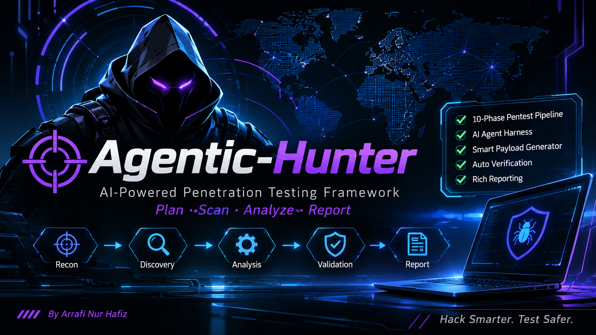

  

  <b>AI-Powered Bug Bounty Reconnaissance, Vulnerability Discovery & Differential Retesting.</b>
   
  <i>Engineered for professional bug bounty hunters, ethical hackers, and defensive security teams.</i>

  <a href="#overview">Overview</a>
  ·
  <a href="#key-capabilities">Key Capabilities</a>
  ·
  <a href="#quickstart">Quickstart</a>
  ·
  <a href="#supported-ai-providers">AI Providers</a>
  ·
  <a href="#cli-commands-reference">CLI Reference</a>
  ·
  <a href="#security--evidence-integrity">Integrity Architecture</a>
  ·
  <a href="#specialized-skills">Skills</a>
  ·
  <a href="#verification--testing">Testing</a>
  ·
  <a href="#disclaimer">Disclaimer</a>

  
  
  
  
  

  Maintained by <b><a href="https://github.com/ArrafiNurHafiz">Arrafi Nur Hafiz</a></b>

---

## Overview

**Agentic Hunter** is an advanced AI-augmented security testing toolkit and autonomous command-line engine built to streamline the entire ethical bug bounty lifecycle. From initial scope verification and asset discovery to attack surface ranking, cryptographic evidence validation, differential fix verification, and audit-ready report generation, Agentic Hunter works directly inside your terminal or as an intelligent agent plugin.

Unlike generic LLM wrappers, Agentic Hunter pairs large language models with **rigorous deterministic guardrails**:
- **Zero Hallucination Proofs**: Findings require verifiable evidence provenance before they can be marked `CONFIRMED`.
- **Offline Differential Retesting**: Automatically compares target snapshots between historical assessments to verify actual fixes without assuming remediation based on absent findings.
- **Provider-Agnostic Engine**: Run 100% locally with free offline models via **Ollama**, route through local **9Router** gateways, connect with **Google OAuth (Gemini 2.0 / 1.5 Pro)**, or leverage ultra-fast inference via **Groq**, **DeepSeek**, **Claude**, or **OpenAI**.
- **Universal Multi-Harness Integration**: Run as a standalone terminal CLI (`bughunter`), or seamlessly plug into **Google Antigravity**, **Claude Code**, **OpenCode**, **Codex**, or **Pi Agent**.
