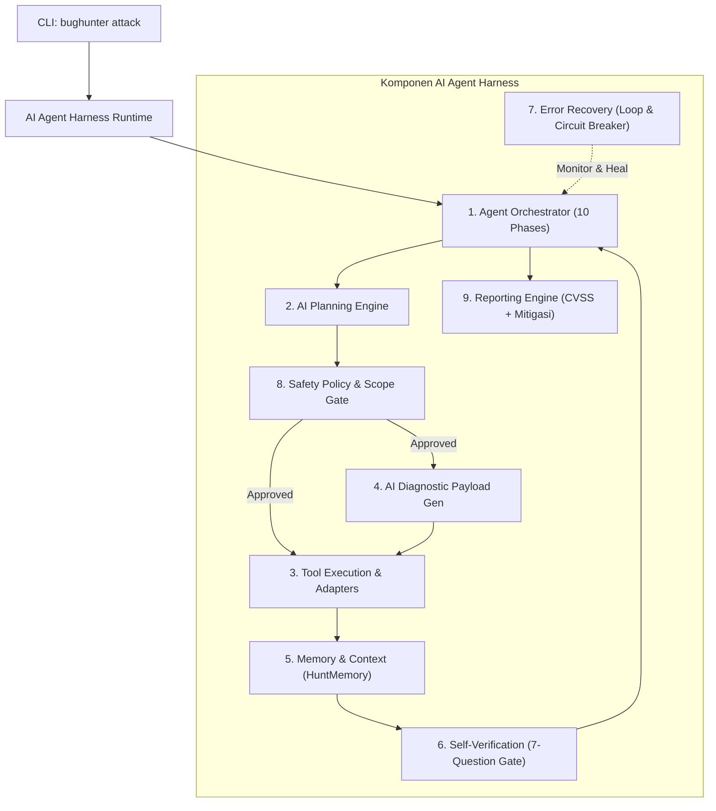
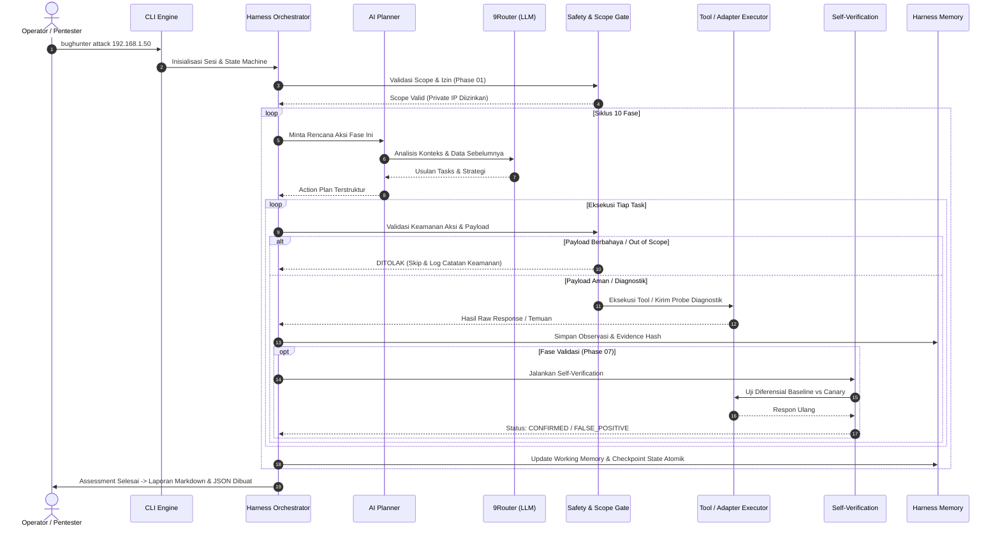

# IMPLEMENTATION PLAN: AI AGENT HARNESS FOR BUGHUNTER

**Project:** BugHunter (Agentic Bug Bounty & Pentesting Framework)  
**Dokumen:** Architectural Implementation Plan — AI Agent Harness  
**Status:** Rencana Kerja / Proposal Arsitektur (Menunggu Persetujuan)  
**Versi Target:** v3.2.0  
**AI Backend:** 9Router (Local Gateway at `http://localhost:20128/v1`) / Brain Layer  

---

## DAFTAR ISI
1. [Ringkasan Eksekutif & Filosofi Harness](#1-ringkasan-eksekutif--filosofi-harness)
2. [Analisis & Pemanfaatan Codebase Eksisting](#2-analisis--pemanfaatan-codebase-eksisting)
3. [Arsitektur Rinci 9 Pilar AI Agent Harness](#3-arsitektur-rinci-9-pilar-ai-agent-harness)
   - [Pilar 1: Agent Orchestrator](#pilar-1-agent-orchestrator)
   - [Pilar 2: AI Planning](#pilar-2-ai-planning)
   - [Pilar 3: Tool Execution & Scanner Adapters](#pilar-3-tool-execution--scanner-adapters)
   - [Pilar 4: AI Payload Generator & Deterministic Safety Gate](#pilar-4-ai-payload-generator--deterministic-safety-gate)
   - [Pilar 5: Memory & Context Engine](#pilar-5-memory--context-engine)
   - [Pilar 6: Self-Verification Engine](#pilar-6-self-verification-engine)
   - [Pilar 7: Error Recovery & Session Resilience](#pilar-7-error-recovery--session-resilience)
   - [Pilar 8: Safety Policy (Zero Private IP Blocking)](#pilar-8-safety-policy-zero-private-ip-blocking)
   - [Pilar 9: Reporting Engine](#pilar-9-reporting-engine)
4. [Struktur Berkas & Direktori Target](#4-struktur-berkas--direktori-target)
5. [Alur Kerja End-to-End & Siklus Eksekusi](#5-alur-kerja-end-to-end--siklus-eksekusi)
6. [Tahapan Implementasi Bertahap (6 Milestones)](#6-tahapan-implementasi-bertahap-6-milestones)
7. [Strategi Pengujian & Jaminan Zero-Regression](#7-strategi-pengujian--jaminan-zero-regression)

---

## 1. RINGKASAN EKSEKUTIF & FILOSOFI HARNESS

**AI Agent Harness** adalah runtime operasional terpadu yang membungkus model AI (Brain/9Router), alat pengujian keamanan eksternal (scanners), memori kontekstual, dan sistem kebijakan keamanan deterministik.

Tujuan utama Harness ini adalah mengubah model LLM dari sekadar chatbot pasif menjadi **Autonomous Security Agent** yang mampu:
- Merencanakan pengujian secara dinamis berdasarkan temuan nyata (*dynamic planning*).
- Menjalankan tool pemindaian dan mengurai hasilnya (*tool execution & observation*).
- Membuat payload diagnostik non-destruktif (*context-aware diagnostic probes*).
- Memverifikasi temuannya sendiri sebelum melapor (*self-verification & false-positive elimination*).
- Mengatasi gangguan jaringan dan error eksekusi secara mandiri (*self-healing & resume checkpoint*).
- Menjaga integritas data target (*risk-minimized, non-destructive by design*).



---

## 2. ANALISIS & PEMANFAATAN CODEBASE EKSISTING

BugHunter telah memiliki fondasi kode yang kuat. Harness ini **tidak akan merusak fitur lama** ataupun menulis ulang logika yang sudah stabil, melainkan mengomposisikannya ke dalam antarmuka terpadu:

| Komponen Eksisting | Lokasi Berkas | Fungsi Saat Ini | Integrasi ke AI Agent Harness |
|---|---|---|---|
| **ReAct Agent** | [bughunter/agent.py](file:///home/arrafi/Proyek/Agentic-Bug-Hunter/bughunter/agent.py#L900-L1150) | ReAct loop built-in berbasis tool-calling native | Menjadi fondasi runtime eksekusi `HarnessOrchestrator` dengan penambahan *phase awareness* 10 fase. |
| **Tool Dispatcher** | [bughunter/agent.py](file:///home/arrafi/Proyek/Agentic-Bug-Hunter/bughunter/agent.py#L400-L800) | Menjalankan `run_recon`, `run_vuln_scan`, `run_js_analysis`, dll. | Diperluas menjadi adapter modular dengan deklarasi *capability manifest*. |
| **Hunt Memory** | [bughunter/agent.py](file:///home/arrafi/Proyek/Agentic-Bug-Hunter/bughunter/agent.py#L300-L390) | 3-layer memory (working notes, observations, findings) | Dipakai sebagai memori operasional agen aktif, diperkuat dengan kompresi konteks. |
| **Brain / 9Router** | [bughunter/brain.py](file:///home/arrafi/Proyek/Agentic-Bug-Hunter/bughunter/brain.py) | Client gateway ke 9Router (`http://localhost:20128/v1`) | Menjadi motor penggerak inferensi LLM untuk planning, reasoning, dan payload synthesis. |
| **Loop Detector** | [bughunter/agent.py](file:///home/arrafi/Proyek/Agentic-Bug-Hunter/bughunter/agent.py#L800-L850) | Deteksi pengulangan tool dalam sliding window 12 panggilan | Digunakan oleh pilar Error Recovery untuk mendeteksi *agent stalling* dan melakukan replanning. |
| **Scope Checker** | [bughunter/tools/scope_checker.py](file:///home/arrafi/Proyek/Agentic-Bug-Hunter/bughunter/tools/scope_checker.py) | Whitelist domain, wildcard, CIDR, dan port | Validasi scope kontinu pada setiap request dan aksi tool. |
| **Safe HTTP** | [bughunter/tools/safe_http.py](file:///home/arrafi/Proyek/Agentic-Bug-Hunter/bughunter/tools/safe_http.py) | Handler redirect aman & pencegahan host escape | Menjaga hop-by-hop redirect agar tidak melompat keluar scope. |
| **Evidence Store** | [bughunter/memory/evidence.py](file:///home/arrafi/Proyek/Agentic-Bug-Hunter/bughunter/memory/evidence.py) | Penyimpanan bukti terstruktur & hash SHA-256 | Menjadi storage bukti forensik yang terikat pada setiap temuan. |
| **Redaction Engine** | [bughunter/memory/redaction.py](file:///home/arrafi/Proyek/Agentic-Bug-Hunter/bughunter/memory/redaction.py) | Masking token, API keys, dan PII | Sanitasi data otomatis sebelum log dan laporan ditulis. |
| **Circuit Breaker** | [bughunter/memory/audit_log.py](file:///home/arrafi/Proyek/Agentic-Bug-Hunter/bughunter/memory/audit_log.py) | Proteksi throttling & jeda error | Mencegah agen membebani target saat terjadi HTTP 5xx berturut-turut. |
| **Pattern DB** | [bughunter/memory/pattern_db.py](file:///home/arrafi/Proyek/Agentic-Bug-Hunter/bughunter/memory/pattern_db.py) | Database teknik sukses lintas target | Sumber referensi strategi pengujian berbasis teknologi target. |
| **Validation Engine** | [bughunter/tools/validate.py](file:///home/arrafi/Proyek/Agentic-Bug-Hunter/bughunter/tools/validate.py) | 7-Question Gate, 4-Gates, kalkulator CVSS | Fondasi utama pilar Self-Verification & Risk Assessment. |

---

## 3. ARSITEKTUR RINCI 9 PILAR AI AGENT HARNESS

### Pilar 1: Agent Orchestrator
- **Tanggung Jawab:** Mengelola *lifecycle* agen melalui 10 fase terstruktur:
  1. `Scope & RoE`: Validasi izin pengujian dan batasan scope.
  2. `Passive Recon`: Pengumpulan OSINT & DNS pasif.
  3. `Active Discovery`: Probing host aktif dan identifikasi port.
  4. `Application Mapping`: Pemetaan rute, endpoint, dan parameter.
  5. `Surface Analysis`: Penilaian bobot risiko lead attack surface.
  6. `Vulnerability Assessment`: Pemindaian berbasis template/signature.
  7. `Controlled Validation`: Pengujian kandidat celah dengan diagnostik minimal.
  8. `Impact & Risk Assessment`: Evaluasi risiko bisnis & kalkulasi CVSS.
  9. `Reporting & Remediation`: Pembuatan laporan Markdown/JSON.
  10. `Differential Retesting`: Verifikasi ulang pasca-perbaikan.
- **Mekanisme Kerja:**
  - Menggunakan status fase: `PENDING`, `RUNNING`, `COMPLETED`, `BLOCKED`, `FAILED`, `SKIPPED`, `NEEDS_REVIEW`.
  - Agen tidak melompat antar fase secara acak; fase berikutnya hanya aktif jika kontrak prasyarat fase sebelumnya berstatus `COMPLETED`.

### Pilar 2: AI Planning Engine
- **Tanggung Jawab:** AI menyusun rencana aksi dinamis (*Dynamic Test Plan*) berdasarkan data yang terkumpul, bukan mengeksekusi secara buta.
- **Struktur Rencana Aksi AI:**
  ```json
  {
    "phase": "06_vulnerability_assessment",
    "target_asset": "http://192.168.1.50:8000",
    "detected_tech": ["PHP 8.2", "Laravel 10", "PostgreSQL"],
    "plan_items": [
      {
        "id": "task_1",
        "action": "run_api_fuzz",
        "endpoint": "/api/v1/orders",
        "rationale": "Endpoint menerima JSON array yang berpotensi memiliki mass-assignment atau parameter handling flaw",
        "priority": "HIGH"
      },
      {
        "id": "task_2",
        "action": "run_diagnostic_probe",
        "vulnerability_class": "IDOR",
        "rationale": "Parameter order_id bersifat sequential numerik tanpa UUID"
      }
    ]
  }
  ```
- **Dynamic Replanning:** Jika pemindaian menemukan endpoint baru (misal: endpoint admin di JS file), AI secara otomatis merevisi rencananya dan memasukkan lead tersebut ke daftar prioritas berikutnya.

### Pilar 3: Tool Execution & Scanner Adapters
- **Tanggung Jawab:** Menyediakan abstraksi eksekusi alat bantu (Nmap, Nuclei, Httpx, Katana, FFuF, Gau, Subfinder) dengan kontrol proses yang ketat.
- **Capability Manifest:** Setiap adapter mendeklarasikan kemampuannya:
  - Mode: `PASSIVE` vs `ACTIVE`
  - Timeout limit dan retry budget.
  - Rate limiting cost (konsumsi token/request per detik).
  - Skema output standar (mengonversi output mentah tool menjadi format seragam `RawFinding`).
- **Isolasi Subproses:** Eksekusi dijalankan via subproses Python dengan batasan `timeout`, pembatasan alokasi memori, serta penanganan error output tanpa men-crash runtime Harness.

### Pilar 4: AI Payload Generator & Deterministic Safety Gate
- **Tanggung Jawab:** Menghasilkan payload diagnostik yang disesuaikan dengan konteks endpoint, parameter, dan teknologi, **tanpa merusak sistem**.
- **Kategori Payload Diagnostik yang Didukung:**
  - **SQLi:** Boolean-based inference (`AND 8419=8419` vs `AND 8419=8420`), sintaks anomali non-ekstraksi, time-delay terkontrol (`pg_sleep(2)`).
  - **XSS:** Reflected canary token acak (`bh_canary_<uuid>`), inspeksi escaping konteks HTML/atribut.
  - **SSRF:** Pemeriksaan DNS query callback unik atau loopback yang terdaftar dalam scope.
  - **SSTI:** Evaluasi ekspresi matematika non-bahaya (`{{7*7}}`, `${9*9}`).
  - **IDOR:** Pengujian perbandingan otorisasi antara 2 akun sah milik operator (*User A vs User B*).
  - **Path Traversal:** Pembacaan berkas statis non-kritis publik/standar (misal: `robots.txt` traversal) tanpa membaca credential/shadow.
- **Deterministic Safety Gate (Aturan Keras):**
  Sebelum payload diteruskan ke jaringan, payload diperiksa oleh validator deterministik:
  - **BLOCKED KEYWORDS:** `DROP`, `DELETE`, `UPDATE`, `INSERT`, `TRUNCATE`, `ALTER`, `INTO OUTFILE`, `LOAD_FILE`, `rm `, `shutdown`, `wget`, `curl`, `nc `, `bash -i`.
  - **Data Minimization:** Dilarang mengambil tabel database massal; maksimal diagnostik hanya membuktikan keberadaan celah.

### Pilar 5: Memory & Context Engine
- **Tanggung Jawab:** Mempertahankan riwayat pengujian, konteks percakapan AI, dan temuan lintas fase tanpa kehabisan *token window*.
- **Tiga Lapisan Memori:**
  1. **Working Memory (Rolling Notes):** Catatan ringkas yang dikelola LLM tentang status target saat ini, hipotesis aktif, dan langkah berikutnya.
  2. **Observations Memory:** Log tereduksi dari hasil eksekusi tool (misal: "Httpx menemukan 4 live host", "Katana mengekstrak 45 endpoint").
  3. **Findings & Evidence Memory:** Temuan terverifikasi yang dilengkapi hash SHA-256 request/response dan metadata keparahan.
- **Context Compactor:** Menggunakan teknik *sliding window* dan ringkasan berkala untuk menjaga prompt tetap padat, relevan, dan efisien saat berkomunikasi dengan 9Router.
- **Pattern DB Linkage:** Mencocokkan teknologi target dengan teknik yang pernah terbukti berhasil di masa lalu melalui `bughunter/memory/pattern_db.py`.

### Pilar 6: Self-Verification Engine
- **Tanggung Jawab:** Memverifikasi temuan secara otonom sebelum dimasukkan ke dalam laporan untuk meminimalkan *false positive*.
- **Alur Verifikasi Berlapis:**
  1. **Reproducibility Test:** Mengulang request minimal 2x untuk memastikan respon deterministik dan bukan *network glitch*.
  2. **Canary Matching:** Memverifikasi apakah string canary unik benar-benar terefleksi persis tanpa sanitasi.
  3. **Negative Baseline Comparison:** Membandingkan respon payload aktif terhadap baseline normal dan respon negatif.
  4. **7-Question Gate Integration:** Menjalankan kriteria validasi 7 pertanyaan dari `bughunter/tools/validate.py`:
     - *Apakah celah ini nyata?*
     - *Apakah berada di dalam scope?*
     - *Apakah dapat dieksploitasi sekarang?*
     - *Bukan duplikat?*
     - *Apakah dampak bisnisnya jelas?*

### Pilar 7: Error Recovery & Session Resilience
- **Tanggung Jawab:** Menjamin stabilitas eksekusi otonom dari interupsi, crash, atau kebuntuan (*infinite loop*).
- **Mekanisme Ketahanan:**
  - **Loop Detection:** `LoopDetector` mendeteksi jika agen memanggil tool yang sama dengan parameter identik berulang kali (>3x berturut-turut). Jika terdeteksi, agen dipaksa untuk *backtrack* atau beralih ke strategi lain.
  - **Circuit Breaker:** Memantau respon HTTP 5xx. Jika target mengalami error berturut-turut (>5x), eksekusi dijeda otomatis (*cooldown*) untuk mencegah gangguan layanan.
  - **Atomic Checkpointing:** Setiap perubahan status fase dan temuan baru disimpan secara atomik ke `~/.bughunter/sessions/<session-id>/state.json` dengan hash SHA-256.
  - **Resume Capability:** Operator dapat mematikan proses (`Ctrl+C`) kapan saja dan melanjutkannya via `bughunter attack resume <session-id>` tanpa kehilangan progres.

### Pilar 8: Safety Policy (Zero Private IP Blocking)
- **Tanggung Jawab:** Membatasi eksekusi hanya pada target yang diizinkan tanpa memblokir lingkungan pengujian lokal/lab.
- **Ketentuan Scope & Policy:**
  - **Zero Private IP Blocking:** IP privat RFC 1918 (`10.0.0.0/8`, `172.16.0.0/12`, `192.168.0.0/16`), loopback (`127.0.0.1`, `localhost`), dan intranet **DIIZINKAN PENUH** untuk mendukung pengujian lokal, homelab, container, dan staging.
  - **Explicit Authorization:** Target harus terdaftar secara eksplisit pada argumen CLI atau berkas `scope.yaml`.
  - **Redirect Guard:** Setiap redirect 3xx divalidasi agar tidak melompat ke host di luar izin scope.
  - **Rate Limiting Defensif:** Batas request rate bawaan (default: 5 req/s) untuk menjaga stabilitas server target.

### Pilar 9: Reporting Engine
- **Tanggung Jawab:** Menghasilkan laporan kerentanan berkualitas tinggi dengan bukti konkret, klasifikasi risiko deterministik, dan panduan mitigasi.
- **Karakteristik Laporan:**
  - **Executive Summary:** Ringkasan postur keamanan untuk pengambil keputusan.
  - **Kalkulasi CVSS Deterministik:** Menggunakan rumus numerik standar CVSS 3.1 & 4.0 dari `bughunter/tools/validate.py`.
  - **Kategorisasi Jelas:** Memisahkan secara tegas antara *Confirmed Vulnerabilities*, *Potential Findings*, dan *Inconclusive Checks*.
  - **Redacted Evidence:** Seluruh token rahasia, password, dan PII telah disamarkan oleh `redaction.py`.
  - **Format Output:** Markdown siap submit (`report.md`) dan JSON terstruktur (`report.json`).

---

## 4. STRUKTUR BERKAS & DIREKTORI TARGET

Penerapan AI Agent Harness dirancang rapi pada direktori baru tanpa mengganggu kode eksisting:

```text
bughunter/
├── harness/                       # [BARU] AI AGENT HARNESS CORE
│   ├── __init__.py
│   ├── orchestrator.py            # HarnessOrchestrator (State machine 10 fase)
│   ├── planner.py                 # AIPlanningEngine (Dynamic planning & tasks)
│   ├── payload_engine.py          # AIPayloadEngine (Context-aware diagnostic generation)
│   ├── safety_gate.py             # Deterministic Safety Gate & Banned Keyword Filter
│   ├── memory.py                  # HarnessMemory (Context compactor & working memory)
│   ├── verifier.py                # SelfVerificationEngine (Differential & 7-Question Gate)
│   ├── recovery.py                # ErrorRecovery & LoopBreaker
│   └── reporter.py                # HarnessReportGenerator (Markdown & JSON)
├── adapters/                      # [BARU] SCANNER ADAPTERS
│   ├── __init__.py
│   ├── base.py                    # BaseScannerAdapter & CapabilityManifest
│   ├── subfinder_adapter.py
│   ├── httpx_adapter.py
│   ├── nmap_adapter.py
│   ├── katana_adapter.py
│   ├── nuclei_adapter.py
│   └── ffuf_adapter.py
├── core/                          # [BARU] FOUNDATION PRIMITIVES
│   ├── __init__.py
│   ├── session.py                 # AssessmentSession & Checkpoint Storage
│   ├── state_machine.py           # PhaseStatus & Contract Validation
│   └── scope.py                   # Continuous Scope Engine (No private IP block)
├── cli/
│   ├── __init__.py
│   └── attack_command.py          # Registrasi 'bughunter attack' CLI subparser
```

---

## 5. ALUR KERJA END-TO-END & SIKLUS EKSEKUSI



---

## 6. TAHAPAN IMPLEMENTASI BERTAHAP (6 MILESTONES)

Implementasi akan dibagi menjadi 6 tahap independen untuk menjamin kehati-hatian (*caution over speed*) dan verifikasi bertahap:

### Milestone 1: Fondasi Arsitektur, State Machine & Sesi
- **Fokus:** Membuat `bughunter/core/state_machine.py`, `bughunter/core/session.py`, `bughunter/core/scope.py`, dan `bughunter/cli/attack_command.py`.
- **Target:** Mendaftarkan sub-perintah `bughunter attack <target>` dengan opsi `--dry-run`, inisialisasi sesi, penulisan atomik `state.json`, dan verifikasi scope tanpa memblokir IP privat.
- **Verifikasi:** Unit test isolasi untuk state machine, verifikasi hash SHA-256 sesi, dan parsing CLI.

### Milestone 2: Scanner Adapters & Execution Layer
- **Fokus:** Membuat `bughunter/adapters/` (Base adapter, Subfinder, Httpx, Nmap, Katana, Nuclei, FFuF).
- **Target:** Isolasi eksekusi scanner dengan *capability manifest*, timeout handling, dan normalisasi output ke format JSON terpadu.
- **Verifikasi:** Unit test dengan mock process stdout untuk memastikan output JSON terstandarisasi.

### Milestone 3: Memory, Context & Error Recovery
- **Fokus:** Mengembangkan `bughunter/harness/memory.py` dan `bughunter/harness/recovery.py`.
- **Target:** Mengintegrasikan `HuntMemory`, `LoopDetector`, dan `CircuitBreaker`. Menambahkan context compactor untuk efisiensi token komunikasi dengan 9Router.
- **Verifikasi:** Pengujian simulasi loop (3x panggilan berulang terdeteksi dan dihentikan) serta simulasi target error (circuit breaker aktif).

### Milestone 4: AI Planning & AI Payload Generator
- **Fokus:** Mengembangkan `bughunter/harness/planner.py`, `bughunter/harness/payload_engine.py`, dan `bughunter/harness/safety_gate.py`.
- **Target:** Menghubungkan 9Router untuk menyusun rencana aksi dinamis, pembuatan payload diagnostik kontekstual (SQLi, XSS, SSRF, SSTI), dan penerapan filter deterministik yang menolak kata kunci destruktif.
- **Verifikasi:** Pengujian filter keamanan (memastikan payload `DROP TABLE`, `rm -rf`, dan webshell 100% ditolak).

### Milestone 5: Self-Verification & Reporting
- **Fokus:** Mengembangkan `bughunter/harness/verifier.py` dan `bughunter/harness/reporter.py`.
- **Target:** Pengujian diferensial otomatis terhadap temuan mentah, integrasi 7-Question Gate, perhitungan deterministik CVSS 3.1 & 4.0, serta pembuatan laporan Markdown & JSON lengkap dengan redaksi data sensitif.
- **Verifikasi:** Pengujian diferensiasi temuan nyata vs false positive pada mock target.

### Milestone 6: Retesting Diferensial, End-to-End QA & Build
- **Fokus:** Mengembangkan logika retest pasca-remediasi, integrasi menyeluruh antar 9 pilar, dan pembangunan executable global.
- **Target:** Sub-command `bughunter retest <session-id>` membandingkan perilaku sebelum dan sesudah patch (`Fixed`, `Still Present`, `Regression`). Seluruh test suite (eksisting + baru) lulus 100%.
- **Verifikasi:** `uv run --with pytest pytest tests/` tetap berstatus **1167+ passed** tanpa regresi sama sekali, disusul rilis tool global via `uv tool install --force .`.

---

## 7. STRATEGI PENGUJIAN & JAMINAN ZERO-REGRESSION

1. **Aturan Pengujian Bebas Efek Samping (Zero External Traffic):**
   - Seluruh test suite otomatis (`pytest`) **hanya** menggunakan mock request, respons buatan, dan fixture lokal. Tidak pernah mengirim paket jaringan ke target publik di luar saat pengujian dijalankan.
2. **Backward Compatibility:**
   - Fitur-fitur eksisting (`bughunter setup`, `bughunter models`, `bughunter providers`, `bughunter recon`, `bughunter hunt`, `bughunter validate`, `bughunter chat`) tidak diubah kontrak dasarnya.
3. **Pemeriksaan Regresi Wajib:**
   - Setiap kali satu milestone selesai dikerjakan, suite 1167 test eksisting dijalankan ulang. Jika ada satu saja test lama yang gagal, pekerjaan tidak boleh dianggap selesai sebelum diperbaiki.

---

## KEPUTUSAN ARSITEKTURAL (ADR SUMMARY)

1. **ADR-01: Arsitektur 9Router Sebagai LLM Gateway Tunggal**
   - *Keputusan:* Semua interaksi kecerdasan buatan Harness disalurkan melalui `bughunter.brain.LLMClient` yang sudah terhubung stabil dengan 9Router (`http://localhost:20128/v1`).
   - *Alasan:* Mendukung 50+ model (Hermes, DeepSeek, Qwen, dll.) secara lokal dan efisien tanpa perlu API key cloud tambahan.
2. **ADR-02: Zero Private IP Blocking**
   - *Keputusan:* Engine tidak akan memblokir alamat IP privat (RFC 1918) maupun localhost.
   - *Alasan:* Kebutuhan pengujian di lingkungan lab internal, intranet, CTF, dan local development.
3. **ADR-03: Pemisahan Ketat AI vs Otorisasi Eksekusi**
   - *Keputusan:* AI hanya boleh mengusulkan rencana dan payload diagnostik. Eksekusi ke jaringan wajib melewati safety gate deterministik berbasis Python code.
   - *Alasan:* Menghilangkan risiko eksploitasi destruktif atau mutasi data yang tidak diinginkan.

---

Dokumen ini adalah cetak biru resmi untuk penambahan AI Agent Harness.  
**Menunggu persetujuan pengguna sebelum memulai pembuatan kode pada Milestone 1.**
