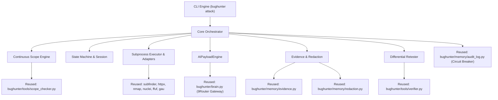
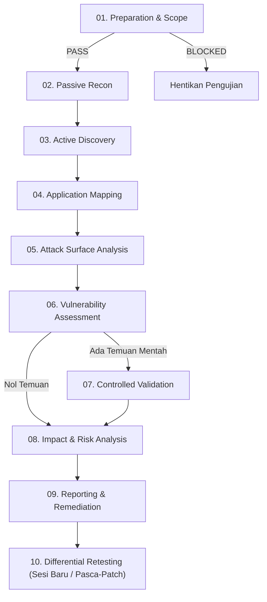
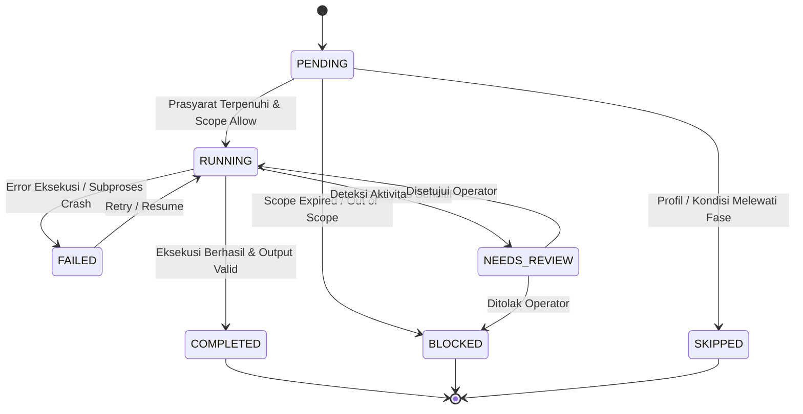
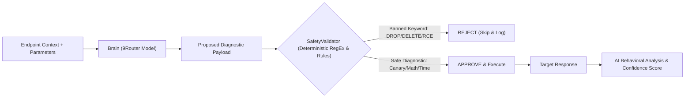

# PANDUAN IMPLEMENTASI ARSITEKTUR BUG HUNTER V3.1
## Standar Rekayasa Web Application Security Assessment Framework
**Sub-Command Utama:** `bughunter attack <target>`  
**Status Dokumen:** Master Implementation Blueprint (Final Specification)  
**Versi:** 3.1.0  
**Target Rilis:** Produksi / Autonomous Security Assessment  

---

## DAFTAR ISI
1. [Prinsip Desain & Filosofi Arsitektur](#1-prinsip-desain--filosofi-arsitektur)
2. [Peta Komponen & Pemanfaatan Codebase Eksisting](#2-peta-komponen--pemanfaatan-codebase-eksisting)
3. [Struktur Direktori Target](#3-struktur-direktori-target)
4. [Siklus 10 Fase Security Assessment](#4-siklus-10-fase-security-assessment)
5. [State Machine & Engine Sesi](#5-state-machine--engine-sesi)
6. [Continuous Scope & Policy Engine (Tanpa Blokir IP Privat)](#6-continuous-scope--policy-engine-tanpa-blokir-ip-privat)
7. [AI Security Engine (AIPayloadEngine + 9Router)](#7-ai-security-engine-aipayloadengine--9router)
8. [Scanner Adapters & Capability Manifest](#8-scanner-adapters--capability-manifest)
9. [Evidence Provenance & Redaction Engine](#9-evidence-provenance--redaction-engine)
10. [Risk Assessment & Reporting Engine](#10-risk-assessment--reporting-engine)
11. [Differential Retesting Engine](#11-differential-retesting-engine)
12. [Spesifikasi Antarmuka CLI](#12-spesifikasi-antarmuka-cli)
13. [Roadmap Implementasi 6 Milestone & Strategi Pengujian](#13-roadmap-implementasi-6-milestone--strategi-pengujian)

---

## 1. PRINSIP DESAIN & FILOSOFI ARSITEKTUR

### 1.1 Risk-Minimized, Non-Destructive by Design
- Istilah *"zero destructive risk"* diganti secara formal dengan pendekatan **Risk-Minimized, Non-Destructive by Design**.
- Seluruh pengujian aktif difokuskan pada **diagnostik non-mutasi**: pembacaan header, refleksi parameter aman, observasi error, dan sintesis *canary value* acak.
- **Larangan Keras Operasi Destruktif:**
  - Dilarang menjalankan query modifikasi basis data (`INSERT`, `UPDATE`, `DELETE`, `DROP`, `TRUNCATE`, `ALTER`).
  - Dilarang melakukan dump data massal (`SELECT * FROM users` dibatasi maksimal `LIMIT 1` atau hanya mengukur waktu respon/error syntax).
  - Dilarang mengekstrak kredensial atau session token riil milik pengguna lain.
  - Dilarang menulis webshell atau menjalankan perintah sistem (`RCE execution proof` cukup membuktikan evaluasi matematika non-bahaya seperti `${7*7}` atau `echo`).
  - Dilarang melakukan perubahan konfigurasi server produksi atau pembebanan berlebih (DoS).
- Jika temuan tidak dapat dibuktikan secara aman tanpa merusak data, temuan tersebut **wajib** diklasifikasikan sebagai `Potential` atau `Inconclusive` dan ditandai untuk review manual.

### 1.2 Zero Private IP Blocking (Full Lab & Intranet Support)
- **Resolusi DNS ke IP Privat TIDAK DIBLOKIR.**
- Range RFC 1918 (`10.0.0.0/8`, `172.16.0.0/12`, `192.168.0.0/16`), loopback (`127.0.0.1`, `localhost`), dan domain lokal (`*.local`, `*.internal`, `*.test`) diizinkan penuh.
- Hal ini menjamin BugHunter dapat digunakan secara optimal untuk menguji aplikasi di *local developer machine*, *Docker containers*, *internal campus/office intranet*, *home lab*, dan *CTF environments*.
- Batasan pengujian semata-mata diatur oleh deklarasi scope pengguna, bukan pemblokiran sepihak oleh engine.

### 1.3 AI Sebagai Penasihat Analitik (Bukan Eksekutor Otonom)
- AI (Brain / 9Router) berfungsi sebagai analis keamanan kognitif: mengelompokkan temuan mentah, menganalisis struktur request/response, memberikan estimasi dampak bisnis, menghitung skor CVSS, dan merekomendasikan langkah remediasi.
- **AI Payload Safety Gate:** Setiap payload yang disarankan AI wajib melewati validator deterministik (pemeriksaan whitelist regex & aturan keamanan ketat) sebelum diteruskan ke antrian pengujian. AI tidak memiliki izin mengeksekusi payload destruktif atau mengubah kebijakan pengujian.

---

## 2. PETA KOMPONEN & PEMANFAATAN CODEBASE EKSISTING

Untuk menjaga prinsip *Simplicity First* dan efisiensi, modul-modul berikut dari repositori BugHunter akan digunakan kembali (*reused*):



| Modul Eksisting | Lokasi Berkas | Pemanfaatan dalam V3.1 |
|---|---|---|
| **Brain / 9Router** | [bughunter/brain.py](file:///home/arrafi/Proyek/Agentic-Bug-Hunter/bughunter/brain.py) | Engine inferensi AI lokal (`http://localhost:20128/v1`) untuk triage, correlation, CVSS scoring, dan deduplikasi. |
| **Scope Checker** | [bughunter/tools/scope_checker.py](file:///home/arrafi/Proyek/Agentic-Bug-Hunter/bughunter/tools/scope_checker.py) | Engine pencocokan domain, wildcard, CIDR, dan port. |
| **Safe HTTP & Redirect** | [bughunter/tools/safe_http.py](file:///home/arrafi/Proyek/Agentic-Bug-Hunter/bughunter/tools/safe_http.py) | Validasi hop-by-hop redirect untuk mencegah DNS rebinding dan redirect keluar dari scope yang diizinkan. |
| **Evidence Store** | [bughunter/memory/evidence.py](file:///home/arrafi/Proyek/Agentic-Bug-Hunter/bughunter/memory/evidence.py) | Penyimpanan bukti terstruktur dengan hashing SHA-256 dan pencatatan timestamp UTC. |
| **Data Redactor** | [bughunter/memory/redaction.py](file:///home/arrafi/Proyek/Agentic-Bug-Hunter/bughunter/memory/redaction.py) | Sanitasi header otorisasi, cookie sesi, API keys, dan data sensitif pengguna. |
| **Audit & Circuit Breaker** | [bughunter/memory/audit_log.py](file:///home/arrafi/Proyek/Agentic-Bug-Hunter/bughunter/memory/audit_log.py) | Rate limiting berbasis token bucket dan proteksi pemutusan darurat jika target merespons HTTP 5xx berturut-turut. |
| **Lead Board** | [bughunter/tools/lead_board.py](file:///home/arrafi/Proyek/Agentic-Bug-Hunter/bughunter/tools/lead_board.py) | Ledger persisten untuk input surface dan deduplikasi lead temuan. |
| **Target Normalization** | [bughunter/tools/target_normalize.py](file:///home/arrafi/Proyek/Agentic-Bug-Hunter/bughunter/tools/target_normalize.py) | Sanitasi nama target, URL scheme parsing, dan deteksi tipe target (domain/IP/local). |
| **CVSS Calculator** | [bughunter/tools/validate.py](file:///home/arrafi/Proyek/Agentic-Bug-Hunter/bughunter/tools/validate.py) | Kalkulator deterministik skor CVSS v3.1 & v4.0. |

---

## 3. STRUKTUR DIREKTORI TARGET

Logika baru akan ditempatkan pada paket modular yang terorganisir di dalam direktori `bughunter/`:

```text
bughunter/
├── cli/
│   ├── __init__.py
│   └── attack_command.py          # Registrasi subparser CLI, parsing flag, dan display banner
├── core/
│   ├── __init__.py
│   ├── state_machine.py           # PhaseStatus Enum, PhaseContract, validasi transisi
│   ├── session.py                 # AssessmentSession, atomic write state.json, verifikasi hash
│   ├── policy_engine.py           # Concurrency limit, rate limiter, circuit breaker, budget limit
│   ├── scope.py                   # Continuous Scope Engine & Redirect Interceptor
│   └── executor.py                # Subprocess runner, timeout handling, graceful cancellation
├── phases/
│   ├── __init__.py
│   ├── base.py                    # BasePhase abstract contract
│   ├── p01_scope.py               # Phase 01: Preparation, Authorization & Scope
│   ├── p02_passive_recon.py       # Phase 02: Passive Reconnaissance (OSINT & DNS)
│   ├── p03_active_discovery.py    # Phase 03: Active Discovery (Host & Service Probe)
│   ├── p04_app_mapping.py         # Phase 04: Application Mapping (URLs & Parameters)
│   ├── p05_surface_analysis.py    # Phase 05: Attack Surface Analysis (Leads & Trust Boundaries)
│   ├── p06_assessment.py          # Phase 06: Vulnerability Assessment (Scanners)
│   ├── p07_validation.py          # Phase 07: AI-Assisted Controlled Validation
│   ├── p08_risk_analysis.py       # Phase 08: Impact & Risk Assessment (CVSS Math & CWE)
│   ├── p09_reporting.py           # Phase 09: Reporting & Remediation (Markdown & JSON)
│   └── p10_retesting.py           # Phase 10: Differential Retesting
├── adapters/
│   ├── __init__.py
│   ├── base.py                    # BaseScannerAdapter & CapabilityManifest
│   ├── subfinder_adapter.py       # Adapter Subfinder
│   ├── httpx_adapter.py           # Adapter Httpx
│   ├── nmap_adapter.py            # Adapter Nmap
│   ├── gau_katana_adapter.py      # Adapter Gau / Katana
│   ├── ffuf_adapter.py            # Adapter Ffuf
│   └── nuclei_adapter.py          # Adapter Nuclei
├── evidence/
│   ├── __init__.py
│   ├── engine.py                  # Evidence Collector & Storage Hub
│   └── deduplicator.py            # Deduplikasi temuan multi-scanner
├── ai/
│   ├── __init__.py
│   ├── payload_engine.py          # AIPayloadEngine (Candidate Generation & Analysis)
│   └── safety_validator.py        # Deterministic Payload Safety Filter
└── tests/
    ├── test_attack_state_machine.py
    ├── test_attack_session.py
    ├── test_attack_scope_engine.py
    ├── test_attack_policy.py
    ├── test_attack_adapters.py
    ├── test_attack_payload_safety.py
    ├── test_attack_evidence.py
    ├── test_attack_reporting.py
    └── test_attack_retest.py
```

---

## 4. SIKLUS 10 FASE SECURITY ASSESSMENT



### Rincian Kontrak Tiap Fase:

#### Fase 01: Preparation, Authorization & Scope
- **Tujuan:** Memvalidasi target, membaca izin pengujian (`scope.yaml`), dan memastikan batas otorisasi aktif.
- **Prasyarat:** Target valid (FQDN/IP/CIDR/URL).
- **Kebijakan Jaringan:** Zero network traffic. Hanya parsing konfigurasi lokal dan validasi waktu kedaluwarsa (`valid_until`).
- **Artefak Output:** `scope_spec.json`.

#### Fase 02: Passive Reconnaissance
- **Tujuan:** Pengumpulan intelijen dari pihak ketiga tanpa menyentuh target langsung.
- **Prasyarat:** Fase 01 berstatus `COMPLETED`.
- **Kebijakan Jaringan:** Hanya menghubungi API publik (crt.sh, AlienVault OTX, HackerTarget, Wayback Machine). Tidak ada koneksi langsung ke host/IP target.
- **Artefak Output:** `passive_subdomains.txt`, `passive_meta.json`.

#### Fase 03: Active Discovery
- **Tujuan:** Verifikasi host yang aktif, resolusi DNS, dan identifikasi port/layanan web yang terbuka.
- **Prasyarat:** Fase 01 berstatus `COMPLETED` dan profil pengujian bukan `passive`.
- **Alat Pendukung:** `subfinder` (aktif), `httpx`, `nmap` (layanan terbatas).
- **Kebijakan Jaringan:** Terbatas pada host dan port dalam scope allowlist. Rate-limited.
- **Artefak Output:** `live_hosts.json`, `open_services.json`.

#### Fase 04: Application Mapping
- **Tujuan:** Menemukan rute aplikasi, API endpoints, formulir login, struktur parameter, dan berkas JavaScript.
- **Prasyarat:** Fase 03 menghasilkan minimal 1 live web host.
- **Alat Pendukung:** `gau`, `katana`, `param_discovery.sh`.
- **Kebijakan Jaringan:** Crawling terbatas (*depth-bounded*, request budget per host).
- **Artefak Output:** `endpoints.json`, `parameters.json`, `auth_endpoints.json`.

#### Fase 05: Attack Surface Analysis
- **Tujuan:** Menilai batas kepercayaan (*trust boundaries*), mengelompokkan parameter berisiko tinggi (misal: `redirect_uri`, `file`, `query`, `id`), dan memprioritaskan lead.
- **Prasyarat:** Fase 04 berstatus `COMPLETED`.
- **Peran AI:** Brain/9Router mengelompokkan surface dan memberikan skor prioritas (1 s.d. 5) pada lead.
- **Kebijakan Jaringan:** Zero network traffic (komputasi heuristik & evaluasi AI).
- **Artefak Output:** `prioritized_leads.jsonl`.

#### Fase 06: Vulnerability Assessment
- **Tujuan:** Scanning berbasis template dan signature untuk mendeteksi potensi kerentanan konfigurasi, header, dan celah umum.
- **Prasyarat:** Fase 05 berstatus `COMPLETED`.
- **Alat Pendukung:** `nuclei`, `ffuf`.
- **Kebijakan Jaringan:** Eksekusi terkontrol dengan template pilihan (tidak menjalankan template eksploitatif destruktif).
- **Artefak Output:** `raw_findings.json`.

#### Fase 07: AI-Assisted Controlled Validation
- **Tujuan:** Mengonfirmasi temuan mentah dengan *diagnostic test* minimal untuk membedakan *true positive* dari *false positive*.
- **Prasyarat:** Fase 06 menghasilkan minimal 1 temuan yang berstatus kandidat.
- **Mekanisme:** 
  1. `AIPayloadEngine` mengusulkan probe diagnostik aman (canary string acak, time-delay wajar).
  2. `SafetyValidator` menyetujui atau menolak payload.
  3. Eksekusi request tunggal, inspeksi respon diferensial, dan pencatatan bukti forensik.
- **Kebijakan Jaringan:** Non-mutating probe saja.
- **Artefak Output:** `validated_findings.json`.

#### Fase 08: Impact & Risk Assessment
- **Tujuan:** Menentukan keparahan (*severity*), menghitung skor CVSS secara deterministik, dan memetakan ke taksonomi CWE / OWASP.
- **Prasyarat:** Fase 06 atau 07 selesai.
- **Peran AI:** Menyusun narasi dampak bisnis (*business impact*), mengidentifikasi akar masalah arsitektural (*root cause*), dan merekomendasikan patch mitigasi.
- **Kalkulasi:** Perhitungan skor numerik CVSS 3.1 & 4.0 dilakukan secara deterministik dengan fungsi matematika, bukan perkiraan AI bebas.
- **Artefak Output:** `risk_assessment.json`.

#### Fase 09: Reporting & Remediation
- **Tujuan:** Mengonsolidasi seluruh artefak menjadi laporan komprehensif berstandar industri.
- **Prasyarat:** Fase 08 berstatus `COMPLETED`.
- **Format:** Markdown (`report.md`) dan JSON (`report.json`).
- **Sanitasi:** Seluruh credential, token, dan data sensitif disamarkan oleh `redactor.py`.
- **Artefak Output:** `reports/ASSESSMENT_REPORT.md`, `reports/ASSESSMENT_REPORT.json`.

#### Fase 10: Differential Retesting
- **Tujuan:** Menguji ulang temuan sebelumnya pasca-remediasi untuk memastikan celah benar-benar tertutup tanpa menimbulkan regresi perilaku.
- **Prasyarat:** Adanya ID sesi historis yang memiliki temuan terkonfirmasi.
- **Klasifikasi Hasil:** `Fixed`, `Still Present`, `Regression`, atau `Inconclusive`.
- **Integritas:** Bukti awal sesi historis tetap dijaga dan tidak ditimpa; laporan retest disimpan sebagai dokumen diferensial terpisah.
- **Artefak Output:** `retest_diff.json`, `reports/RETEST_REPORT.md`.

---

## 5. STATE MACHINE & ENGINE SESI

### 5.1 Definisi Status Fase (`PhaseStatus`)
```python
from enum import Enum

class PhaseStatus(str, Enum):
    PENDING = "pending"          # Belum dijadwalkan / menunggu prasyarat
    RUNNING = "running"          # Sedang dalam proses eksekusi
    COMPLETED = "completed"      # Berhasil selesai dan valid
    BLOCKED = "blocked"          # Ditolak oleh scope / authorization policy
    FAILED = "failed"            # Terhenti karena kesalahan sistem/jaringan
    SKIPPED = "skipped"          # Dilewati karena kondisi opsional tidak terpenuhi
    NEEDS_REVIEW = "needs_review"# Membutuhkan otorisasi manual manusia
```

### 5.2 Diagram Status Transisi


### 5.3 Manajemen Sesi & Penyimpanan Atomik (`SessionManager`)
- **Struktur Direktori Sesi:**
  `~/.bughunter/sessions/<session_id>/`
  - `state.json`: State machine snapshot dan metadata sesi.
  - `state.sha256`: Hash integritas state untuk mendeteksi modifikasi liar.
  - `scope.yaml`: Salinan scope yang disetujui untuk sesi tersebut.
  - `artifacts/`: Seluruh berkas JSON/TXT yang dihasilkan tiap fase.
  - `evidence/`: Bukti request/response terhash.
- **Atomic File Write:**
  Penyimpanan `state.json` dilakukan dengan menulis ke `state.json.tmp` terlebih dahulu, lalu di-*rename* secara atomik (`os.replace`) untuk mencegah kerusakan file jika terjadi interupsi daya/proses.
- **Resume Protocol:**
  Saat operator menjalankan `bughunter attack resume <session_id>`:
  1. Membaca `state.json` dan memverifikasi kecocokan hash dengan `state.sha256`.
  2. Mengecek apakah `valid_until` pada scope masih berlaku di waktu saat ini.
  3. Melanjutkan eksekusi dari fase pertama yang berstatus `PENDING` atau `FAILED`.

---

## 6. CONTINUOUS SCOPE & POLICY ENGINE (TANPA BLOKIR IP PRIVAT)

### 6.1 Spesifikasi Scope Deklaratif (`scope.yaml`)
```yaml
version: "1.0"
target_name: "Internal Enterprise Staging & Lab"
authorized_by: "AppSec Team Lead"
valid_until: "2027-12-31T23:59:59Z"

in_scope:
  domains:
    - "*.corp.local"
    - "app.corp.local"
    - "example.test"
  ips_and_cidrs:
    - "127.0.0.1"
    - "localhost"
    - "192.168.1.0/24"
    - "10.10.10.0/24"
    - "172.16.0.50"
  ports: [80, 443, 3000, 8000, 8080, 8443]

out_of_scope:
  domains:
    - "production-gateway.corp.local"
  ips:
    - "192.168.1.254"

policy:
  allow_private_ips: true       # EKSPLISIT: Jangan blokir RFC1918 / Localhost
  allow_public_ips: true
  max_requests_per_second: 5
  max_concurrency: 2
  circuit_breaker_error_threshold: 5
```

### 6.2 Continuous Scope Enforcement Interceptor
Setiap adapter atau pemanggilan HTTP wajib melewati fungsi validasi:
```python
def validate_action(url: str, method: str, scope: ScopeChecker) -> ScopeDecision:
    # 1. Cek masa berlaku otorisasi
    if scope.is_expired():
        return ScopeDecision.BLOCK_EXPIRED
    
    # 2. Parse hostname dan port
    host, port = extract_host_port(url)
    
    # 3. Validasi allowlist target (Mendukung penuh IP privat jika terdaftar)
    if not scope.is_in_scope(url):
        return ScopeDecision.BLOCK_OUT_OF_SCOPE
        
    # 4. Validasi metode HTTP (Hanya metode aman/non-destruktif: GET, POST, HEAD, OPTIONS)
    if method.upper() not in ("GET", "POST", "HEAD", "OPTIONS"):
        return ScopeDecision.BLOCK_UNSAFE_METHOD
        
    return ScopeDecision.ALLOW
```

### 6.3 Redirect Hop-by-Hop Interceptor
Jika target mengembalikan status HTTP 301/302/307:
- Destinasi header `Location:` diperiksa sebelum diikuti.
- Jika redirect mengarah ke host di luar allowlist scope, redirect **tidak diikuti** dan dicatat dalam audit log.

---

## 7. AI SECURITY ENGINE (AIPAYLOADENGINE + 9ROUTER)



### 7.1 Aturan Payload Aman (`SafetyValidator`)
- **SQLi:** Menggunakan *syntactic anomaly check* dan observasi boolean non-mutasi (`' OR '1'='1`, `AND 1=1 vs 1=2`), atau time delay terkontrol (`sleep(2)`). Larangan keras: `INSERT`, `UPDATE`, `DELETE`, `DROP`, `UNION SELECT` untuk data dumping massal.
- **XSS:** Menggunakan string canary alfanumerik acak (`bh_canary_<random>`) untuk mendeteksi refleksi langsung pada body/atribut HTML tanpa payload eksekusi JavaScript destruktif.
- **SSRF:** Menggunakan identifier OOB unik atau loopback domain yang telah disetujui dalam scope.
- **IDOR:** Pengujian pembandingan akses antara dua akun uji terotorisasi milik operator (*User A vs User B*), bukan menebak ID pengguna riil.

---

## 8. SCANNER ADAPTERS & CAPABILITY MANIFEST

Setiap scanner eksternal diisolasi dalam adapter yang mengimplementasikan interface terstandar:

```python
class Capability(Enum):
    PASSIVE_RECON = "passive_recon"
    HOST_DISCOVERY = "host_discovery"
    PORT_SCAN = "port_scan"
    URL_CRAWL = "url_crawl"
    PARAM_DISCOVERY = "param_discovery"
    VULN_SCAN = "vuln_scan"

@dataclass
class CapabilityManifest:
    name: str
    capabilities: list[Capability]
    is_passive_only: bool
    requires_network: bool
    supports_json_output: bool
    rate_limit_supported: bool

class BaseScannerAdapter(ABC):
    @property
    @abstractmethod
    def manifest(self) -> CapabilityManifest:
        pass
        
    @abstractmethod
    def health_check(self) -> bool:
        """Cek apakah binary tersedia dan berfungsi."""
        pass
        
    @abstractmethod
    def run(self, target: str, options: dict) -> list[RawFinding]:
        """Eksekusi proses dengan timeout, isolation, dan JSON output."""
        pass
```

---

## 9. EVIDENCE PROVENANCE & REDACTION ENGINE

Setiap bukti temuan yang dihasilkan dicatat dalam format `EvidenceRecord`:

```json
{
  "evidence_id": "ev_8a7d6e5c4b3a",
  "session_id": "sess_20261123_103045",
  "finding_id": "find_xss_search_param",
  "vuln_class": "Reflected XSS",
  "target_url": "http://localhost:8000/search?q=bh_canary_9921",
  "timestamp_utc": "2026-11-23T04:15:30.123Z",
  "source_tool": "nuclei",
  "request": {
    "method": "GET",
    "uri": "/search?q=bh_canary_9921",
    "headers": {
      "Host": "localhost:8000",
      "User-Agent": "BugHunter/3.1 (Security Assessment)",
      "Authorization": "[REDACTED_BEARER_TOKEN]"
    },
    "body_sha256": "e3b0c44298fc1c149afbf4c8996fb92427ae41e4649b934ca495991b7852b855"
  },
  "response": {
    "status_code": 200,
    "headers": {
      "Content-Type": "text/html; charset=utf-8"
    },
    "reflected_canary": true,
    "body_sha256": "7a8b9c0d1e2f3a4b5c6d7e8f9a0b1c2d3e4f5a6b7c8d9e0f1a2b3c4d5e6f7a8b"
  },
  "confidence_score": 0.95,
  "validation_status": "CONFIRMED"
}
```

---

## 10. RISK ASSESSMENT & REPORTING ENGINE

### 10.1 Rumus CVSS Deterministik
Perhitungan skor CVSS dihitung menggunakan algoritma deterministik matematis (`bughunter/tools/validate.py`):
- `CVSS 3.1 Base Score`: Formula standar FIRST.org (fungsi AV, AC, PR, UI, S, C, I, A).
- `CVSS 4.0 Score`: Evaluasi 11 metrik (AV, AC, AT, PR, UI, VC, VI, VA, SC, SI, SA).
- AI hanya merekomendasikan nilai vektor metrik berdasarkan konteks teknis, sedangkan skor numerik dihitung secara deterministik oleh Python code.

### 10.2 Format Laporan Markdown
Laporan `reports/ASSESSMENT_REPORT.md` menyajikan:
1. **Executive Summary**: Ringkasan temuan, postur keamanan, dan metrik total risiko.
2. **Scope & Rules of Engagement**: Target yang diizinkan dan batasan waktu pengujian.
3. **Confirmed Findings**: Bukti teknis langkah reproduksi deterministik.
4. **Potential / Inconclusive Findings**: Indikasi awal yang membutuhkan analisis manual lebih dalam.
5. **Remediation Plan**: Rekomendasi mitigasi prioritas untuk developer.

---

## 11. DIFFERENTIAL RETESTING ENGINE

Retesting (`bughunter retest <session-id>`) membandingkan perilaku keamanan sebelum dan sesudah perbaikan:

| Klasifikasi | Kriteria Pengujian | Aksi Laporan |
|---|---|---|
| **Fixed** | Payload diagnostik aman ditolak dengan benar (misal: sanitasi aktif, encoded, atau di-filter oleh validasi input) dan aplikasi berfungsi normal. | Temuan ditandai *Resolved* dengan bukti perbandingan baru. |
| **Still Present** | Perilaku kerentanan masih persis sama seperti pada sesi referensi. | Temuan tetap berstatus *Open*. |
| **Regression** | Patch menimbulkan eror 500, crash, atau membuka attack vector baru di endpoint yang sama. | Temuan dinaikkan statusnya menjadi *Regression*. |
| **Inconclusive** | Endpoint tidak dapat diakses (HTTP 404/503) atau struktur arsitektur berubah total. | Ditandai untuk evaluasi manual. |

---

## 12. SPESIFIKASI ANTARMUKA CLI

```bash
# 1. Menjalankan assessment lengkap pada target
bughunter attack target.com

# 2. Menjalankan assessment dengan dokumen scope deklaratif
bughunter attack 192.168.1.100 --scope scope.yaml

# 3. Validasi konfigurasi & parsing fase tanpa mengirim traffic (Dry-Run)
bughunter attack localhost:8000 --dry-run

# 4. Assessment pasif 100% (Zero direct contact)
bughunter attack target.com --profile passive

# 5. Assessment terbatas pada fase tertentu (misal: fase 1 s.d. 3)
bughunter attack target.com --phase 1-3

# 6. Melanjutkan sesi yang sempat terhenti
bughunter attack resume sess_20261123_103045

# 7. Memeriksa progres dan status tiap fase sesi
bughunter attack status sess_20261123_103045

# 8. Menghasilkan ulang laporan dari sesi yang ada
bughunter report sess_20261123_103045 --format markdown

# 9. Retesting terhadap patch temuan sesi lama
bughunter retest sess_20261123_103045
```

---

## 13. ROADMAP IMPLEMENTASI 6 MILESTONE & STRATEGI PENGUJIAN

| Milestone | Ruang Lingkup & Berkas yang Dibuat/Dimodifikasi | Kriteria Verifikasi Sukses |
|---|---|---|
| **Milestone 1: Core Architecture** | • `bughunter/core/state_machine.py`<br>• `bughunter/core/session.py`<br>• `bughunter/phases/base.py`<br>• `bughunter/cli/attack_command.py`<br>• `bughunter/engine.py` (wiring CLI subparser) | `bughunter attack --help` berfungsi, state machine 10 fase teruji, penyimpanan atomik `state.json` + verifikasi SHA-256 berhasil.<br>Test: `tests/test_attack_milestone1.py` PASS 100%. |
| **Milestone 2: Safety & Authorization** | • `bughunter/core/scope.py`<br>• `bughunter/core/policy_engine.py`<br>• `bughunter/core/executor.py` | Dukungan penuh IP privat (RFC1918/localhost), interceptor hop-by-hop redirect, circuit breaker teruji saat target error.<br>Test: `tests/test_attack_milestone2.py` PASS 100%. |
| **Milestone 3: Passive Assessment** | • `bughunter/phases/p01_scope.py`<br>• `bughunter/phases/p02_passive_recon.py`<br>• `bughunter/evidence/engine.py` | Profil passive berhasil mengekstrak aset via OSINT tanpa mengirim koneksi langsung ke target. Bukti terhash SHA-256.<br>Test: `tests/test_attack_milestone3.py` PASS 100%. |
| **Milestone 4: Scanner Adapters** | • `bughunter/adapters/*`<br>• `bughunter/phases/p03_active_discovery.py`<br>• `bughunter/phases/p04_app_mapping.py`<br>• `bughunter/phases/p05_surface_analysis.py`<br>• `bughunter/phases/p06_assessment.py` | Adapter Httpx, Nmap, Nuclei, FFuF, Subfinder memproduksi output JSON seragam. Rate limit ditaati.<br>Test: `tests/test_attack_milestone4.py` PASS 100%. |
| **Milestone 5: AI Engine, Validation & Reporting** | • `bughunter/ai/payload_engine.py`<br>• `bughunter/ai/safety_validator.py`<br>• `bughunter/phases/p07_validation.py`<br>• `bughunter/phases/p08_risk_analysis.py`<br>• `bughunter/phases/p09_reporting.py`<br>• `bughunter/evidence/deduplicator.py` | Integrasi 9Router menghasilkan payload diagnostik aman, filter mendepak payload destruktif, CVSS dihitung presisi, laporan Markdown rapi.<br>Test: `tests/test_attack_milestone5.py` PASS 100%. |
| **Milestone 6: Retesting, QA & Global Tool Build** | • `bughunter/phases/p10_retesting.py`<br>• Full regression suite<br>• `uv tool install --force .` | Retesting diferensial berfungsi, 1167 test repo eksisting tetap 100% green tanpa regresi, CLI global terverifikasi end-to-end.<br>Test: Full suite PASS (0 error). |

---

### Verifikasi Lingkungan & Aturan Pengujian
- **Zero Mock Contamination:** Pengujian unit test hanya menggunakan mock session atau fixture lokal, tidak pernah menembakkan traffic ke target eksternal riil saat menjalankan `pytest`.
- **Zero Regression:** Sebelum setiap milestone dinyatakan selesai, seluruh suite test (`tests/`) wajib dijalankan ulang dan memastikan nol kegagalan.
